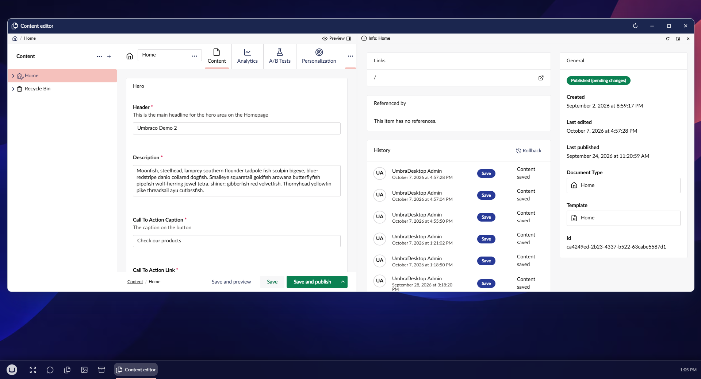

# Views beside the editor

A document window shows one of its views at a time: Content, Info, and any views packages add. Some
of them are worth seeing while you edit, such as the template, links and history on Info. The desktop
can keep such a view open beside the editor.

It is not a copy. The view beside the editor shows the same document, live, and its actions apply to
it. Unsaved edits show in it straight away, picking a template in it marks the document unsaved, and
a dialog it opens, such as the template picker, opens in the document window.

## Open a view beside the editor

When a document window shows a view other than Content, the path under its title bar names that view,
such as Home / Info. A view that can open beside the editor has a side-panel button next to its name.

1. In the document window, select the view's tab, such as **Info**.
2. In the path, select the panel button next to the view's name. The view opens beside the
   editor, and the window goes back to Content.

To open it as a window of its own instead, hold Shift while you select the button.

Several views can be open beside one window at once, and beside the preview. Each view opens once per
window. While it is docked, its button is not in the path: select **Hide** in its header to put it
away, and the button comes back. While it is in a window of its own, the button shows as pressed, and
selecting it closes that window.

## Docked or in a window

A view beside the editor works the same way as the preview: it opens docked when there is room and
as a window of its own when there is not, and it can be popped out and docked again. See
[Live preview](live-preview.md#docked-or-in-a-window).

It belongs to its document window. It rises, minimises and closes with that window, and it closes
when the window moves to a different document. When the window reloads, the view reconnects to the
reloaded document. That can take a few seconds, and the view says it is waiting until then.

## Links in the view

A link in the view goes where it would from the view's tab, in the document window. The document
type and template links on Info open as a dialog there, and the view stays open. A link to another
document moves the document window there, which closes the view. A link that opens a new browser tab
still does.

## Views that cannot open beside the editor

Some views have no side-panel button:

- **Content**, and other editors, such as Workflow's view. An editor is what the window is already
  showing.
- Views with tabs of their own, such as Engage's Analytics and Personalization. They keep their place
  in the address, which only works in their own window. The path still names them.

A package can also keep one of its views out, if it does not work beside the editor.

## Turn it off

To stop document windows offering this, open Desktop settings, select **General**, and turn off
**Offer to open workspace views beside the editor**. Any views open beside a window close at once.
See [Desktop settings](../settings/desktop-settings.md).
