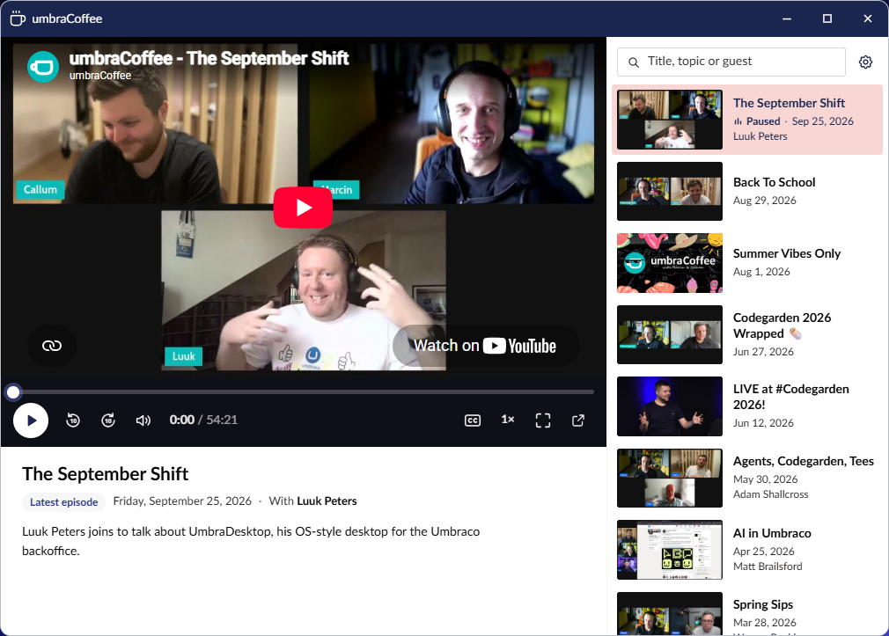
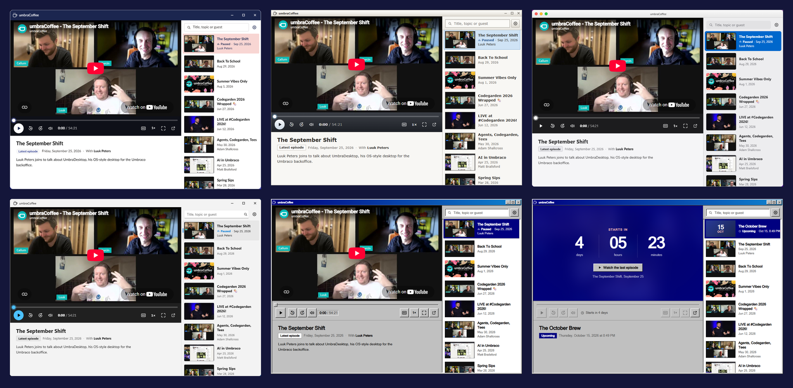
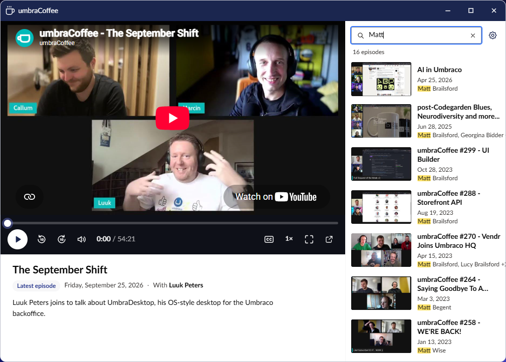
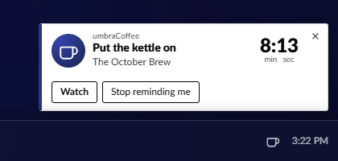

# umbraCoffee

umbraCoffee is the Umbraco community's monthly live show. The UmbraDesktop Entertainment Add-on puts it on the
desktop in a window of its own, in the launcher's **Media** group. It comes with the same package as
the [games](games.md), so installing it is the same one command.

## Watch

To open it, open the launcher and select **umbraCoffee** in the Media group. The window opens on
whatever matters now:

- **Live:** the stream, with **Chat** and **Episodes** tabs beside it, open on **Chat**. Reading the
  chat needs nothing. Posting in it needs you signed in to YouTube in that browser, with third-party
  cookies allowed.
- **Upcoming:** a countdown in days, hours and minutes where the picture will be, with a
  **Watch the last episode** button under it.
- **Otherwise:** the latest episode, ready to play.

Under the picture is the episode: its title, then a line with a tag saying **Live**, **Upcoming** or
**Latest episode**, its date, and its guests after **With**, then a short summary of what it covers.
Times are written like the desktop's clock, following your Regional format and Clock settings. An
episode with no summary or no guests leaves that part out.

The video is YouTube's own player, with umbraCoffee's controls in a bar under it: a seek line, then
play, back and forward 10 seconds, volume and the time, and at the right captions, speed, full screen
and **Watch on YouTube**. Speed steps through 1, 1.25, 1.5 and 2 times. Where the bar is less than
720 pixels wide, it leaves out the volume slider, keeping the mute button, and shows **Watch on
YouTube** as an icon only.

The list beside the player shows the episodes newest first, thirty at a time, with **Show more**
under them. Select one to play it in place. In a narrow window the list moves under the player. The
window can be resized down to 520 pixels wide, and maximised. umbraCoffee opens one window at a time,
so opening it again brings the one you have to the front.

The window looks native under each of the desktop's themes.

## Find an old episode

To find an old episode, type in the search field above the list, **Title, topic or guest**. It looks
in every episode's title, summary and guest names, ignores case and accents, and every word you type
has to match. It searches the whole archive, not just the rows already shown. While you search, the
number of matching episodes shows under the field, and the matches are highlighted. When nothing
matches, **Show all episodes** clears the search.

## The tray cup and the reminders

You do not have to remember to open it. While an episode is coming up or live, umbraCoffee's coffee
cup sits in the taskbar beside the clock: plain while the episode is coming up, steaming once it is
live. Point at it for the title and how long until it starts, and select it to open umbraCoffee. The
rest of the month the cup is not there at all.

The desktop also reminds you twice per episode: ten minutes before it starts, and again when it goes
live. The first says **Put the kettle on** with a countdown to the start, then **Starting now**. The
second says **Grab a cuppa!** and **On air**, and replaces the first. Each has two buttons:
**Watch** (**Watch now** once it is live) opens umbraCoffee, and **Stop reminding me** turns the cup
and the reminders off. Each reminder is shown once per episode in each browser, so a second tab or a
reload does not repeat it. The notification list behind the clock keeps a one-line copy of each.

The cup and the reminders are one switch, on by default. To switch them off, do either of these:

- In Desktop settings, select **Taskbar** and switch **umbraCoffee** off under **System tray icons**.
- In the umbraCoffee window, select **Settings**, the gear at the top right, and switch **Remind me**
  off under **Reminders**.

The two are the same switch, so they stay in step. The umbraCoffee app itself stays in the launcher
either way.

## Where umbraCoffee gets its data

Your server makes no outbound calls for umbraCoffee, and nothing needs configuring. A scheduled job in
this package's GitHub repository, which is where the package's source lives, reads the umbraCoffee
channel and keeps the data up to date on a branch called `data/umbracoffee`. The editor's browser
reads two small JSON files from it on `raw.githubusercontent.com`: the list of episodes, and the next
episode when one is coming up or live. So the only machine that talks to GitHub is the one the editor
is sitting at. Reading GitHub is not tied to the Umbraco session, so it never keeps an idle
backoffice session signed in.

The browser looks every 30 minutes, and every minute while an episode is live or about to start. The
job that writes the files runs about every five minutes, though GitHub sometimes starts a run 10 to
15 minutes late. Stream pages go public well before the show starts, so the reminders still come in
good time, and a next-episode file that has not been refreshed for half an hour is ignored rather
than trusted.

If the browser cannot reach GitHub, for example behind a proxy that blocks it, a warning sign shows
beside the gear. Point at it, or move to it with the keyboard, to read why, and the date the episodes
it shows are up to: the ones that came with the package. There is no countdown, no cup and no
reminders until it is back, and the **Remind me** switch in the settings is unavailable, with the
reason under it. It checks again on its next look.

The package ships a snapshot of the episode list for exactly that case, summaries and guests
included. It is refreshed before each release, so it can be some weeks behind. The browser only loads
it when it cannot reach GitHub.

### Where the summaries and guests come from

Each episode's summary and guest list were written once from its YouTube description by an AI model,
and the maintainer reviewed them. They live on the same data branch and reach your browser in the
episode list, so nothing calls an AI from your server or your browser. The guests are only the people
the description names as being on the show, never the hosts.

New episodes are filled in by the maintainer on their own machine, about once a month. So a new
episode can show in the list with no summary and no guests for a while, and search finds it by its
title until then.

### If your site has a Content Security Policy

Umbraco sets none by default. If yours adds one, umbraCoffee needs these allowed in the backoffice:

| Directive | Host |
| --- | --- |
| `script-src` | `https://www.youtube.com` |
| `frame-src` | `https://www.youtube.com`, `https://www.youtube-nocookie.com` |
| `img-src` | `https://i.ytimg.com` |
| `connect-src` | `https://raw.githubusercontent.com` |

Without them the window still opens, but the player, the chat, the thumbnails or the data will be
blocked, and a blocked data host looks like being offline.

## YouTube's terms

The video and the chat are YouTube's own embeds, so using them is using YouTube. By using umbraCoffee
you agree to be bound by the [YouTube Terms of Service](https://www.youtube.com/t/terms). The package
itself collects nothing about you. What it stores stays in your browser: your **Remind me** choice,
which is kept with the rest of your desktop settings, and a note of which reminders it has already
shown you.

## Writing your own

Nothing in this package is privileged. The `umbraDesktopTrayItem` manifest that puts the umbraCoffee
cup beside the clock is public API that any package can register, the same as the `umbraDesktopApp`
manifest that puts each app in a window. See
[Building a desktop app](https://github.com/Luuk1983/Umbraco.Community.UmbraDesktop/blob/main/docs/developer/desktop-apps.md)
in the UmbraDesktop developer guide, whose tray section covers the tray item, the tray context and
notifications with buttons.
To try the cup and the reminders without waiting for a show, see
[Testing umbraCoffee](../developer/umbracoffee-testing.md).
