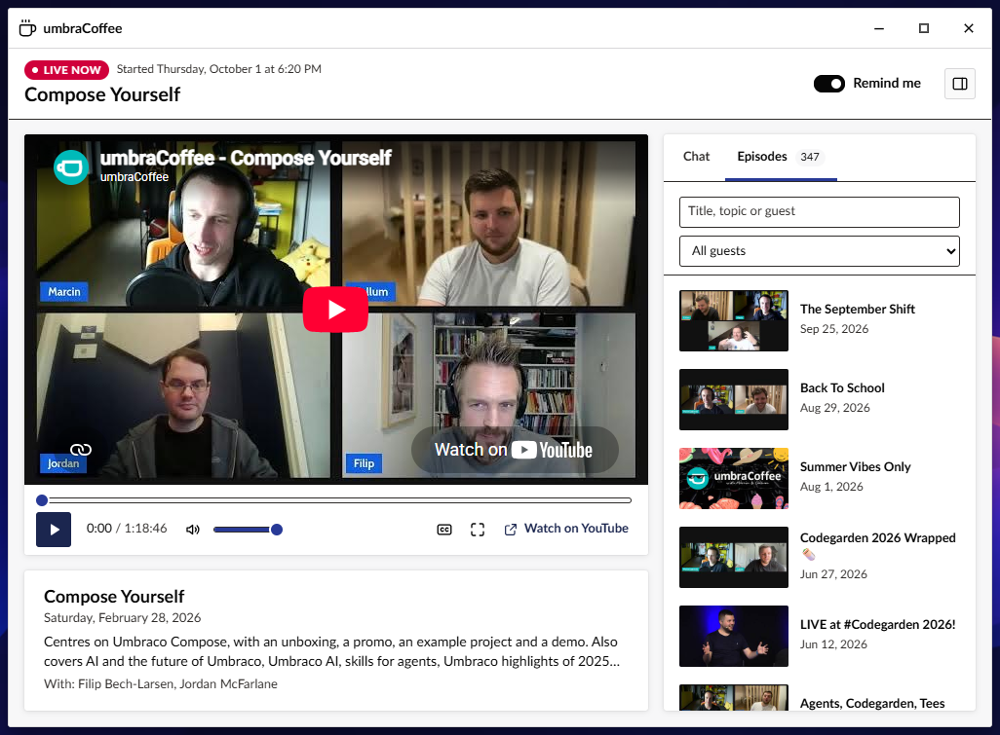
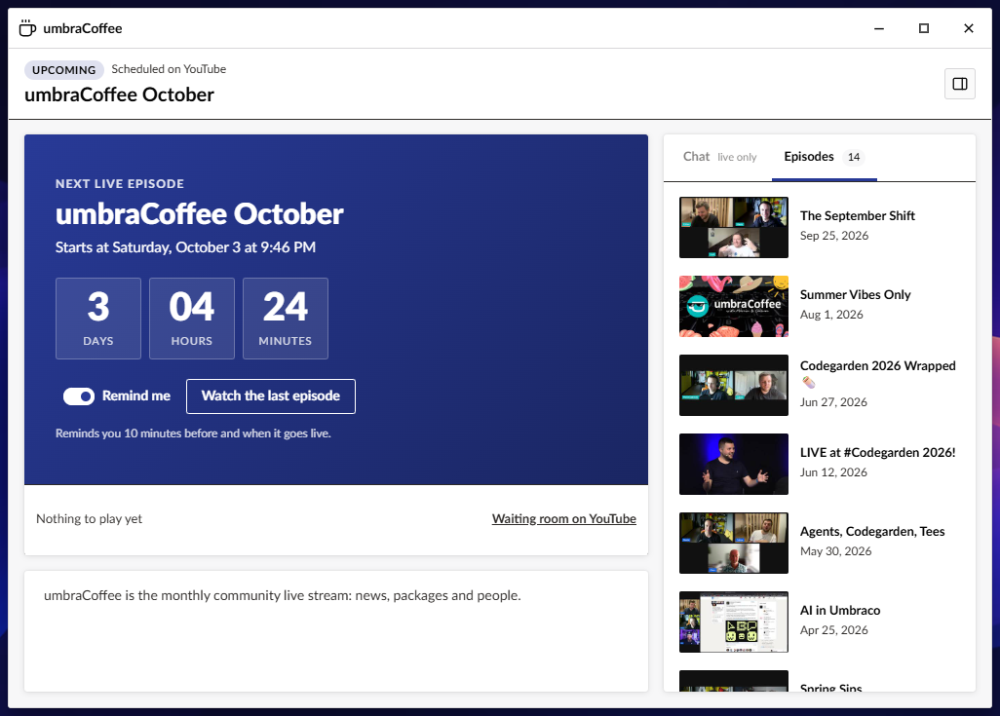

# umbraCoffee

umbraCoffee is the Umbraco community's monthly live show. UmbraDesktop Entertainment puts it on the
desktop in a window of its own, in the launcher's **Media** group. It comes with the same package as
the [games](games.md), so installing it is the same one command.

## Watch

To open it, open the launcher and select **umbraCoffee** in the Media group. The window opens on
whatever matters now:

- **Live:** the stream, with the live chat beside it. Reading the chat needs nothing; posting in it
  needs you signed in to YouTube in that browser, with third-party cookies allowed.
- **Coming up:** a countdown in days, hours and minutes, with the start time written like the
  desktop's clock, following your Regional format and Clock settings.
- **Otherwise:** the latest episode, ready to play.

The video is YouTube's own player, but the controls under it are umbraCoffee's: play and pause, a
seek bar, volume, captions, full screen and a link to watch on YouTube. They are drawn in the style of
the theme you picked, so the window looks native under each of the five and follows the light or dark
palette of the desktop.

The side panel beside the player has two tabs, **Chat** (live only) and **Episodes**, newest first,
thirty at a time, each playable in place. A button in the header hides the panel, and a window too
narrow for both moves it under the player. The window can be resized and maximised. umbraCoffee
opens one window at a time, so opening it again brings the one you have to the front.

Under the player is the episode playing: its title, its date, a short summary of what it covers, and
its guests on a line starting **With**. An episode with nothing to say there leaves that part out.

## Find an old episode

To find an old episode, use the search field at the top of **Episodes**, **Title, topic or guest**.
It looks in every episode's title, summary and guest names, ignores case and accents, and every word
you type has to match. Under it, **All guests** lists everyone who has been on the show with how many
episodes they were in, so you can pick one person and see only their episodes. Both work on the
whole archive, not just the rows already shown, and the panel says how many episodes match. When
nothing does, **Show all episodes** clears both.

## The tray cup and the reminders

You do not have to remember to open it. While an episode is coming up or live, a coffee cup sits in
the taskbar beside the clock: steaming while it is coming up, with a red dot once it is live. Point
at it for the title and how long until it starts, and select it to open umbraCoffee. The rest of the
month the cup is not there at all.

The desktop also reminds you twice per episode: ten minutes before it starts, and again when it goes
live. Each reminder has two buttons. **Watch** opens umbraCoffee, and **Stop reminding me** turns the
cup and the reminders off. Each reminder is shown once per episode in each browser, so a second tab
or a reload does not repeat it.

The cup and the reminders are one switch, on by default. To switch them off, do either of these:

- In Desktop settings, select **Taskbar** and switch **umbraCoffee** off under **System tray icons**.
- In the umbraCoffee window, switch **Remind me** off.

The two stay in step, even with both open. The umbraCoffee app itself stays in the launcher either
way.

## Where umbraCoffee gets its data

Your server makes no outbound calls for umbraCoffee, and nothing needs configuring. A scheduled job in
this package's GitHub repository, which is where the package's source lives, reads the umbraCoffee
channel and keeps the data up to date on a branch called `data/umbracoffee`. The editor's browser
reads two small JSON files from it on `raw.githubusercontent.com`: the list of episodes, and the next
episode when one is coming up or live. So the only machine that talks to GitHub is the one the editor
is sitting at. Reading GitHub is not tied to the Umbraco session, so it never keeps an idle
backoffice session signed in.

The browser looks every 30 minutes, and every minute while an episode is live or about to start. The
job that writes the files runs about every five minutes, though GitHub sometimes starts a run 10 to
15 minutes late. Stream pages go public well before the show starts, so the reminders still come in
good time, and a next-episode file that has not been refreshed for half an hour is ignored rather
than trusted.

If the browser cannot reach GitHub, for example behind a proxy that blocks it, umbraCoffee says so at
the top of the window and shows the episodes that came with the package, with the date they are up
to. There is no countdown, no cup and no reminders until it is back, and the **Remind me** switch
shows as unavailable with the reason. It checks again on its next look.

The package ships a snapshot of the episode list for exactly that case, summaries and guests
included. It is refreshed before each release, so it can be some weeks behind. The browser only loads
it when it cannot reach GitHub.

### Where the summaries and guests come from

Each episode's summary and guest list were written once from its YouTube description by an AI model,
and the maintainer reviewed them. They live on the same data branch and reach your browser in the
episode list, so nothing calls an AI from your server or your browser. The guests are only the people
the description names as being on the show, never the hosts.

New episodes are filled in by the maintainer on their own machine, about once a month. So a new
episode can show in the list with no summary and no guests for a while, and search finds it by its
title until then.

### If your site has a Content Security Policy

Umbraco sets none by default. If yours adds one, umbraCoffee needs these allowed in the backoffice:

| Directive | Host |
| --- | --- |
| `script-src` | `https://www.youtube.com` |
| `frame-src` | `https://www.youtube.com`, `https://www.youtube-nocookie.com` |
| `img-src` | `https://i.ytimg.com` |
| `connect-src` | `https://raw.githubusercontent.com` |

Without them the window still opens, but the player, the chat, the thumbnails or the data will be
blocked, and a blocked data host looks like being offline.

## YouTube's terms

The video and the chat are YouTube's own embeds, so using them is using YouTube. By using umbraCoffee
you agree to be bound by the [YouTube Terms of Service](https://www.youtube.com/t/terms). The package
itself collects nothing about you. What it stores stays in your browser: your **Remind me** choice,
which is kept with the rest of your desktop settings, and a note of which reminders it has already
shown you.

## Writing your own

Nothing in this package is privileged. The `umbraDesktopTrayItem` manifest that puts the umbraCoffee
cup beside the clock is public API that any package can register, the same as the `umbraDesktopApp`
manifest that puts each app in a window. See
[Building a desktop app](https://github.com/Luuk1983/Umbraco.Community.UmbraDesktop/blob/main/docs/developer/desktop-apps.md)
in the UmbraDesktop developer guide, whose tray section covers the tray item, the tray context and
notifications with buttons.
