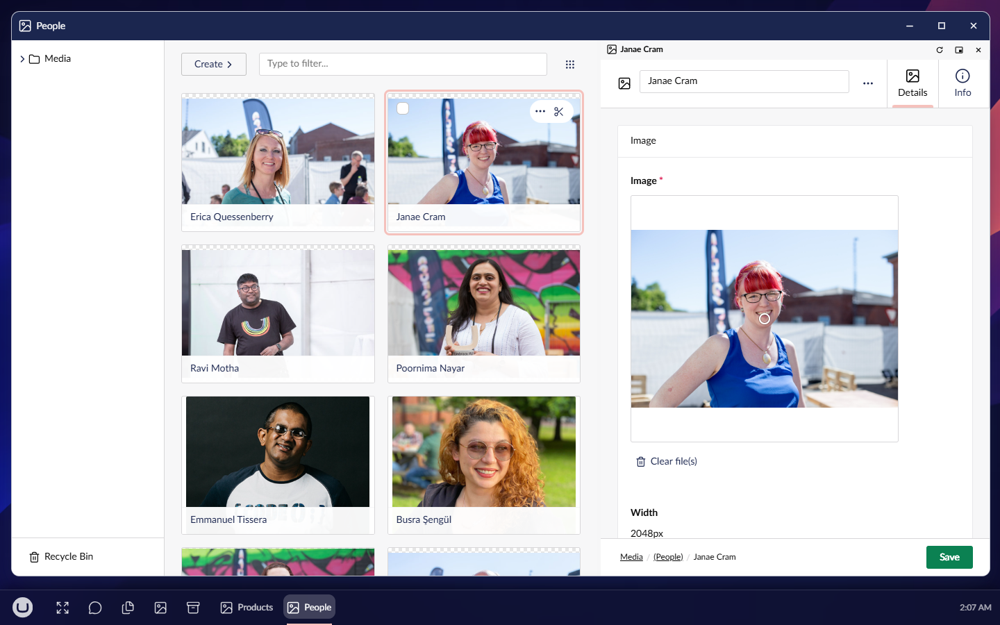

# UmbraDesktop Media Add-on

The media library, the way you manage files on your own computer. Open folders in as many windows as you like, drag between them, cut, copy and paste, drop files and whole folders from your computer, and undo what you did, on top of everything the Media section already does. And an Image Editor to fix an image without leaving the backoffice.

[](https://www.nuget.org/packages/Umbraco.Community.UmbraDesktop.Media) [](https://www.nuget.org/packages/Umbraco.Community.UmbraDesktop.Media) [](../../LICENSE)



The Media Manager hosts Umbraco's own media library inside its windows rather than rebuilding it, so every media type, including your own, and every package that adds to the Media section keep working in it. The Media section stays exactly as Umbraco ships it.


The Image Editor works on an image from the media library and saves it back or as a copy:

- **Crop, rotate and flip**, free or to a ratio, with the image's focal point shown.
- **Adjust** exposure, brightness, contrast and saturation, and compare with the original.
- **Mark up** with text, arrows, boxes and a pen, and **redact** what should not be seen, burned into the saved file.
- **Resize**, and **save** over the image or as a copy, in JPEG, PNG or WebP, with the size before and after.

[Optimize images](docs/user/optimize-images.md) does the same chore for a whole selection at once: resize, convert to WebP and remove the metadata of fifty camera photos in one run, in a window of its own.

## Get started

```bash
dotnet add package Umbraco.Community.UmbraDesktop.Media
```

That is all. UmbraDesktop comes with it if you do not have it yet, and the Media Manager and the Image Editor appear in a Media group in the launcher for anyone who can reach the desktop and the Media section. You need Umbraco 18.1 or later and .NET 10. On Umbraco 17, install a 17.x release.

[Media Manager](docs/user/media-manager.md) and [Image Editor](docs/user/image-editor.md) explain how to use them.

## License

[MIT](../../LICENSE). The bundled library, Fabric.js, is MIT too; its notice is in [THIRD-PARTY-NOTICES.md](THIRD-PARTY-NOTICES.md).
