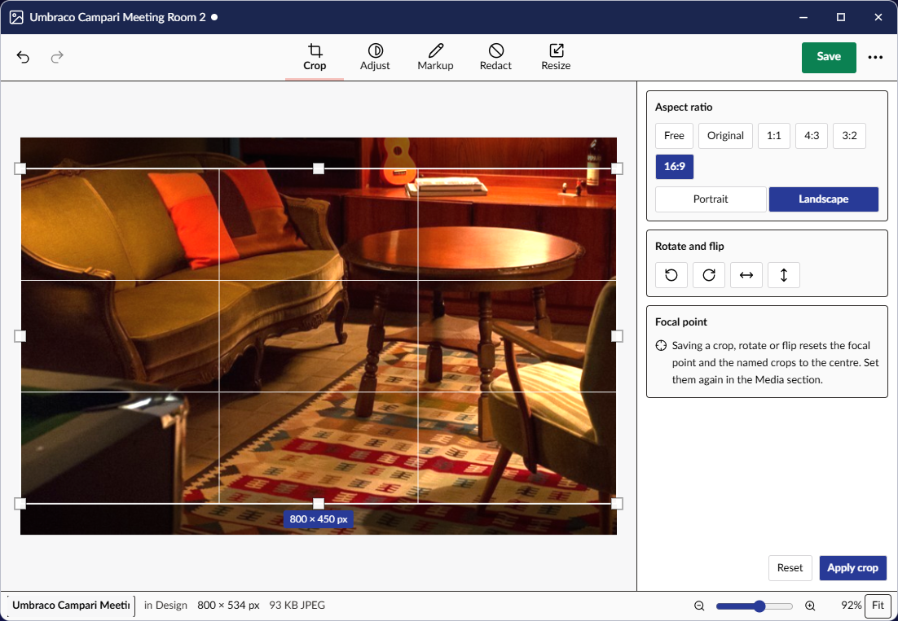

# Image Editor

The Image Editor fixes an image from the media library without leaving the backoffice: crop it,
correct its light, mark it up, hide what should not be seen, shrink it, and save it back over the
same media item or as a copy. It is in the launcher's **Media** group, after **Media Manager**, for
everyone who may use the Media section.

The window has five modes along the top, **Crop**, **Adjust**, **Markup**, **Redact** and
**Resize**, each with its settings in the panel on the right. **Undo** and **Redo** are at the left.
**Save** and **More** (**...**) are together in the right corner: **More** opens the menu with
**Open**, **Save**, **Save as**, **Info** and **Close**. The status bar shows the image's name, its
folder, its size and format, and zoom.

## Open an image

With nothing open, the editor shows **Open an image**. Once an image is open, select **More** >
**Open**, or press Ctrl+O.

- To open an image you worked on lately, select it under **Recent images in the media library**.
- To open any other image, select **Browse the media library...** and pick it.
- To add an image from your computer first, select **Upload from this computer...**, and use the
  media picker's own upload.

## Open an image from the media library

To edit an image you are looking at in the media library, open it and select **Edit image**, left of
**Save** at the bottom of its page. The Image Editor opens in its own window with that image. If an
editor window already has that image open, that window comes to the front instead.

**Edit image** is in a few more places:

- In a Media Manager window, it is the button on an image's card.
- In an image's actions menu (**...**), in the tree, the grid and the list, in the Media section too.
- In the **...** beside the image's **Image** property.

The same places have the file's other tools: see [What you can do with a file](media-item.md).

To edit an image a page uses, start from the page:

1. In the page's media picker, select the image. Its crops open.
2. Select **Open in Media Library**. The image's own page opens over the page.
3. Open the actions menu (**...**) at the top, and select **Edit image**.

**Edit image** is on images only, not on files, SVGs or folders, and not on what is in the recycle
bin. It is on the desktop only: the backoffice without the desktop does not show it.

An editor window reopens at the image it had after the browser reloads. Unsaved changes are lost on a
reload, as they are in any window.

## When someone else saves the image

When the image you have open is saved somewhere else, by another window or another person, the editor
follows:

- With no unsaved changes, it opens the new picture by itself.
- With unsaved changes, its window says **Someone else changed this while you were editing it**.
  Select **Discard mine, load theirs** to open their picture, or **Keep my changes** to carry on.
  When you then save, the editor asks before it writes over their version.

## What the editor opens

The editor opens JPEG, PNG, WebP, GIF and BMP images. It refuses an SVG, which is a drawing rather
than pixels. An animated GIF opens on its first frame, and saving keeps only that frame. A phone photo
is shown upright, however the phone held it.

## Crop, rotate and flip

1. Select **Crop**.
2. Optional: to keep a shape, select a ratio under **Aspect ratio**, such as **1:1** or **16:9**, and
   **Portrait** or **Landscape**.
3. Drag the frame or its handles. Its size in pixels is shown under it.
4. To crop, select **Apply crop**, or press Enter. The picture is cropped at once. To throw the frame
   away instead, press Escape.

To cut further in, crop again. To get the whole picture back, select **Reset**, or **Undo**.

To turn the image, select **Rotate left** or **Rotate right**. To mirror it, select **Flip
horizontal** or **Flip vertical**. Both happen at once.

In Crop the image's focal point is drawn on the picture. Saving, or saving a copy, after a crop,
rotate or flip resets the focal point and the image's named crops to the centre, because they would point at the wrong
part of the new picture. Set them again in the Media section. Resizing, adjusting, marking up and
redacting keep them.

## Adjust the light and colour

1. Select **Adjust**.
2. Drag **Exposure**, **Brightness**, **Contrast** or **Saturation**. The picture changes as you
   drag. To put a slider back to 0, double-click it.

To see the original, hold **Hold to compare**. To see the original and the adjusted picture side by
side, select **Split view**, and drag the line.

## Mark up

1. Select **Markup**.
2. Choose a tool: **Text**, **Arrow**, **Box** or **Pen**.
3. Choose a colour, and a **Width** for lines.
4. Draw on the picture. For text, select where it goes and type.

To change a mark, choose **Select** and select the mark: drag it to move it, drag its handles to
resize it, or choose another colour or width. To remove it, select **Delete** or press Delete.

Marks stay movable until you save. In the saved file they are part of the picture.

## Hide what should not be seen

1. Select **Redact**.
2. Choose **Pixelate** or **Blur**, and a **Strength**.
3. Drag over what should not be seen: a face, a name, a number plate.

Each area keeps its own style and strength. To change one, select it; to remove it, select
**Delete**. The redaction is burned into the saved file, and the original pixels under it are gone
from that file. The strength starts high on purpose: a light blur can be undone by software.

## Resize

1. Select **Resize**.
2. Type a **Width** or a **Height**, in **Pixels** or **Percent**, or select one of the **Common
   widths**. While **Keep proportions** is on, the other side follows.
3. Select **Apply size**. The status bar shows the size before and after until you save.

The common widths only make an image smaller. To make it bigger, type the size.

## Zoom

Zoom is at the right of the status bar: **Zoom out**, the slider, **Zoom in**, and **Fit**. Ctrl+plus
and Ctrl+minus zoom too, Ctrl+0 fits the picture to the window and Ctrl+1 shows it at 100%. Hold Ctrl
and turn the mouse wheel, or pinch, to zoom where you point. To move around a zoomed picture, hold
Space and drag, or drag with two fingers.

## Save

- To save over the image in its own format, select **Save**, or press Ctrl+S.
- To choose a format, a quality or a copy, select **More** > **Save as**, or press Ctrl+Shift+S.

On **Save as**:

1. Choose **Replace** the image, or **Save a copy**. A copy gets a **Name** and goes next to the
   original; to put it somewhere else, select **Change...**.
2. Choose a **Format**: **Keep**, JPEG, PNG or WebP. For JPEG and WebP, choose a **Quality**.
   **Now** and **After** show the file's size before and after, measured on the real picture.
3. Select **Save copy**, or **Replace** and the image's name, at the bottom of the panel.

Saving over an image gives its file a new address, as uploading a replacement in the Media section
does, so pages and windows show the new picture rather than an old copy. Every window on the desktop
showing the image, in a Media Manager or the Media section, shows the new picture at once. Pages that
pick the image keep working; a link someone pasted to the old file breaks.

A copy keeps the original's media type and properties, such as its alt text, focal point and crops,
with the new picture as its file. After a copy is saved, the editor is on the copy, and the next save
writes to the copy.

- If the folder you chose does not allow the original's media type, or that type does not take the
  format you chose, nothing is saved and the status bar says why. Choose another folder or format.
- If another file on the image cannot be copied, such as a second upload, the copy is made without
  it, and the status bar says which.
- If the original was deleted or moved to the recycle bin meanwhile, the copy is a new image without
  its properties, and the status bar says so.

A GIF or BMP cannot be written back in its own format, so **Save** opens **Save as** with PNG chosen.

Saving re-encodes the picture, which removes its camera and location data. Umbraco keeps no older
version of an image, so save a copy to keep the original.

If the image is used elsewhere, on pages, members or other media, the first save over it asks
first, saying how many places use it: saving changes it in all of them. Select **Save** to go on, or
**Cancel** and use **Save as** to save a copy instead. **More** > **Info** shows the same count, under
**Used in**.

If somebody else changed the image in the Media section after you opened it, the editor asks before
it overwrites their version. If the media library refuses the save, the reason is in the status bar.

## Undo

Every change is one step: a crop, a turn, one slider drag, one mark, one area. **Undo** and **Redo**
are at the left of the bar, and Ctrl+Z and Ctrl+Y do the same. Saving does not end the history: you can undo
past a save, and the window shows it has unsaved changes again.

## Info and Close

To see the image's name, folder, dimensions, size, format, last change and how many places use it,
select **More** > **Info**.

To close the window, select **More** > **Close**. If there are unsaved changes, the desktop asks
first.

To put the menu away without choosing anything, press Escape, select **Close menu**, or select the
picture beside it.
