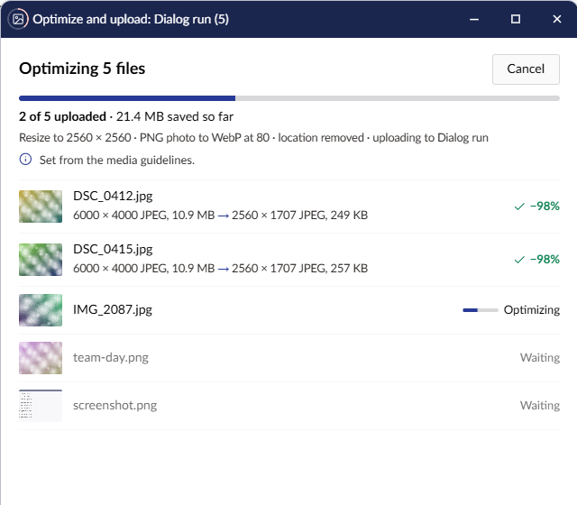
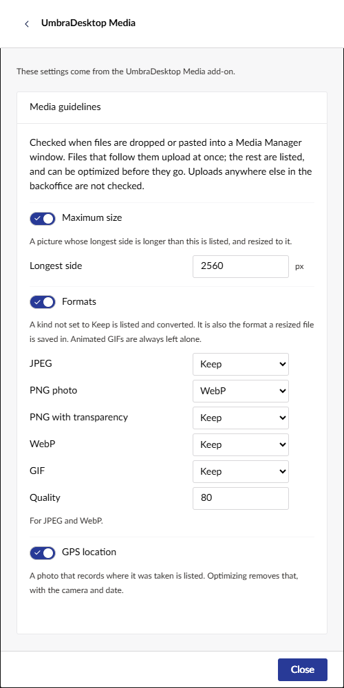

# Media guidelines

Photos straight from a camera or a phone are often 6000 pixels wide, several megabytes, and record
where they were taken. The **Media guidelines** catch them on their way in. When you drop or paste
files into a Media Manager window, each one is checked in the browser before it is uploaded. Files
that follow the guidelines upload at once, as they always did. The rest are listed, and you choose
what happens to them.

The guidelines are on from the start, so a site that never opens their settings still gets them.

## What is checked

Three guidelines, each with a switch:

- **Maximum size**: a picture whose longest side is longer than this, 2560 pixels to start with.
- **Formats**: what each kind of file should be. There is a row for **JPEG**, **PNG photo**, **PNG
  with transparency**, **WebP** and **GIF**, each set to **Keep**, JPEG, PNG or WebP, and one
  **Quality** for JPEG and WebP. A row not set to **Keep** lists the file. To start with, PNG photos go
  to WebP and the rest are kept. Animated GIFs are always left alone.
- **GPS location**: a photo that records where it was taken.

A PNG with no transparent pixel counts as a PNG photo. A screenshot does too; you can untick it in the
warning.

Files are also checked against Umbraco's own upload limit, when the site sets one
(`Umbraco:CMS:Runtime:MaxRequestLength`). Umbraco refuses a larger file, so it is listed with the rest,
and optimizing it can bring it under the limit. This check has no switch.

Only files dropped or pasted into a Media Manager window are checked. Uploads in the Media section's
own window, in media pickers on content pages, and from other apps, such as **Save as** in the
[Image Editor](image-editor.md), are not. Files inside a folder you drop upload as they are.

## When a file breaks a guideline

A dialog opens over the window you dropped the files on. Only that window waits; the rest of the
desktop carries on. The files that follow the guidelines are already uploading.

Under the heading **Media guidelines** are the site's guidelines at their shortest, each with its
icon, such as "2560 px" and "No GPS". Below them is each file that breaks one, with its picture, what it
is, and what Optimize will do to it, such as **Resize to 2560 px**, **Convert to WebP** or **Remove
GPS**, each with its guideline's icon. Every file is ticked; an unticked one says it uploads as it is.

- To fix them before they upload, untick any you want left alone, then select **Optimize**. The
  unticked ones upload as they are.
- To upload all of them unchanged, select **Upload as they are**.
- To upload none of them, close the dialog or press Esc. The window says how many files were not
  uploaded.
- To see or change the guidelines, select **Guideline settings**.

While the dialog is open, you can still move, resize and minimise the window it belongs to. A click in
the window brings the dialog forward.

## Optimize them, then upload

**Optimize** starts at once, in an Optimize images window of its own, with the guidelines' settings.
Each file is optimized in the browser and then uploaded into the folder, one at a time, so each appears
as it lands. The progress shows on the window's title bar and its taskbar button.

A file only gets the fixes for what it breaks. A JPEG whose only problem is its GPS location has it
removed, with the camera and date, and its picture is not saved again. A file that is saved anew, such
as a resized one, is saved in its row's format when that row is not **Keep**.

If a file fails, it says why, and nothing of it is uploaded.

- To try it again, select **Retry**.
- To upload it as it was dropped, select **Upload the original**.

Closing the window while it runs asks first. Files already uploaded stay.

## Change the guidelines

The guidelines are one set for the whole site. Anyone can see them. Only users with the Settings
section can change them; for everyone else they are read only, and the box says why.

1. Open **Desktop settings**, then **Add-ons**, then **UmbraDesktop Media**.
2. In **Media guidelines**, change what you need. A change is saved at once, for everyone on the site.

A switch that is off keeps its settings in view, greyed. The next drop into a Media Manager uses the
new guidelines.
